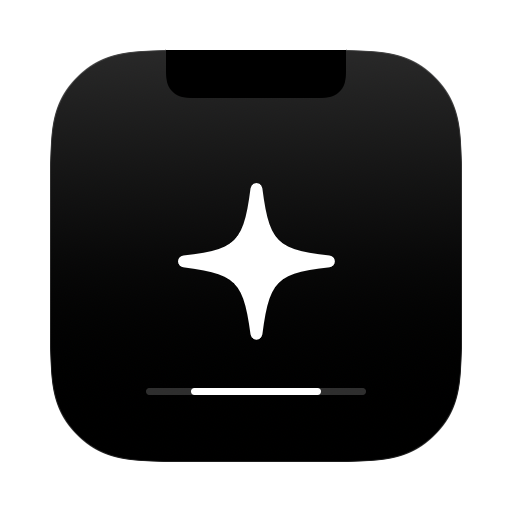
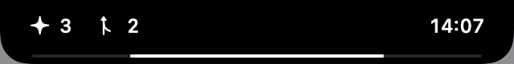
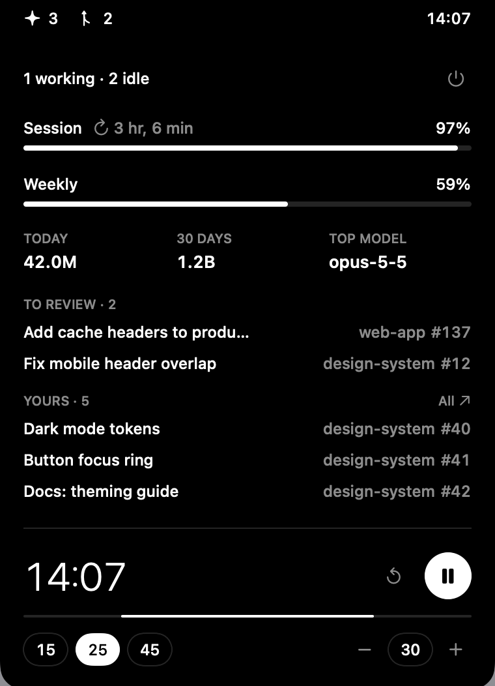

<p align="center">
  
</p>

<h1 align="center">Nook</h1>

<p align="center">
  <b>Your agents, in the Nook.</b><br>
  A tiny ✦ that lives in your MacBook notch and keeps an eye on Claude Code, your limits, your PRs and your focus.<br>
  Black and white. No dock icon. No distractions.
</p>

<p align="center">
  
  
  
  <a href="https://buymeacoffee.com/BMC_USERNAME"></a>
</p>

<p align="center">
  <br><br>
  
</p>

---

## Why

You run Claude Code agents all day. You keep switching windows to check if they're done, how much of your session is left, and whether someone is waiting on your review. Nook puts all of it where your eyes already are — the notch — and gets out of the way the rest of the time.

## Meet the ✦

Nook is a small companion with one job: keep watch so you don't have to.

- **Asleep** — faded, when no agents are open
- **Awake** — still and white, when your agents are idle and waiting for you
- **Busy** — spinning, while an agent is working
- **Calling you** — opens the notch and chimes when a focus session ends

## What it shows

| | |
|---|---|
| **Agents** | ✦ spins while a Claude Code session is working, sits still when idle, fades when none are open |
| **Limits** | Session (5h) and weekly usage left, with time to reset |
| **Tokens** | Today, last 30 days, and your top model — read from local Claude Code logs |
| **Pull requests** | PRs waiting for your review, and PRs you opened or are assigned to. Click to open |
| **Focus timer** | 15 / 25 / 45 min presets or a custom length. Collapsed, it's a single hairline draining into the notch |
| **Focus complete** | Pauses Spotify, Apple Music and YouTube, loops a chime, and opens the notch until you dismiss it |

Hover the notch to expand. Move away to collapse.

## Install

Requirements: macOS 15 or later, Xcode Command Line Tools (`xcode-select --install`).

```sh
git clone https://github.com/Met96/nook.git
cd nook
./build.sh
```

This compiles the app, installs it to `/Applications` and launches it. Open it later from Spotlight like any other app.

**Start at login:** System Settings → General → Login Items → **+** → Nook.

**Quit:** expand the notch and click the power button.

## Setup

### Claude — no API key needed

Nook does **not** ask for an Anthropic API key. It reuses the login you already have in Claude Code:

1. Install [Claude Code](https://claude.com/claude-code) and sign in once (`claude`, then `/login`).
2. Launch Nook. macOS asks to let it read the **"Claude Code-credentials"** Keychain item → **Always Allow**.

Agents and token stats work without this step — they come from `~/.claude/projects`. Only the session/weekly limits need the Keychain access.

### GitHub pull requests (optional)

Uses the [GitHub CLI](https://cli.github.com) login, no token to paste:

```sh
brew install gh
gh auth login
```

No `gh`? The PR lists just stay empty.

### Permissions you'll see

| Prompt | Why | Required |
|---|---|---|
| Keychain: "Claude Code-credentials" | Read your Claude Code login to fetch limits | For limits only |
| Automation: Spotify / Music | Pause playback when a focus session ends | Optional |

Change them anytime in **System Settings → Privacy & Security**.

## Privacy

Everything runs on your Mac. Nook makes exactly two kinds of network calls:

- `api.anthropic.com` — your own usage limits, with your own Claude Code token
- GitHub, through your `gh` CLI — your open PRs

No analytics, no servers, no accounts.

## Good to know

- **Limits use an undocumented endpoint** (the one Claude Code's `/usage` uses). If Anthropic changes it, limits show `–` until it's updated; everything else keeps working.
- **"Working" means** a Claude Code session wrote to its log in the last 10 seconds.
- **YouTube pausing** goes through macOS's private MediaRemote framework, which Apple sometimes restricts. Spotify and Music are paused directly and are more reliable.
- **No notch?** It sits at the top center of your main screen instead.

## Develop

Everything is in one file, `main.swift`. After editing:

```sh
./build.sh
```

Render the UI states to PNG without launching the app:

```sh
./build.sh --no-install
build/Nook.app/Contents/MacOS/Nook --snapshot docs
```

To change the icon, edit `icon.swift`, delete `AppIcon.icns` and rebuild.

## Uninstall

```sh
pkill -x Nook; rm -rf /Applications/Nook.app
```

## Support

If Nook saves you a few context switches a day, you can buy me a coffee ☕

<a href="https://buymeacoffee.com/BMC_USERNAME"></a>

## License

[MIT](LICENSE) © Mattia Marescotti

Nook is an independent project, not affiliated with or endorsed by Anthropic.
